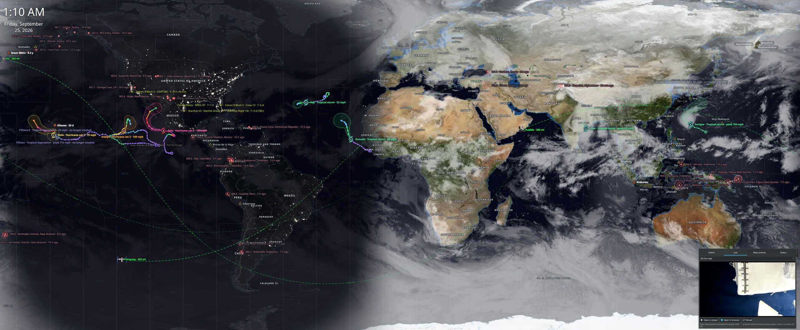
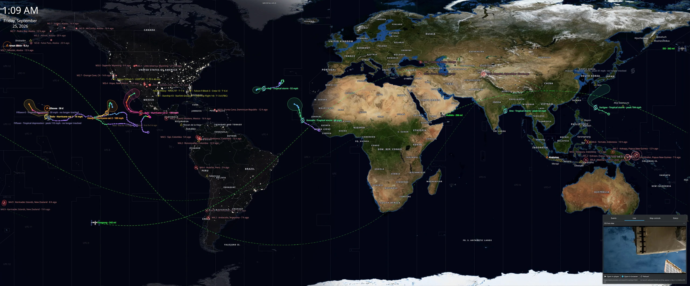
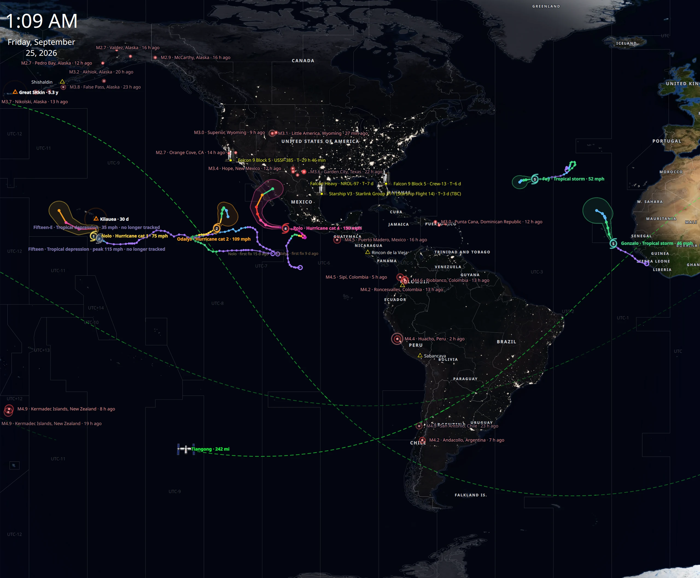
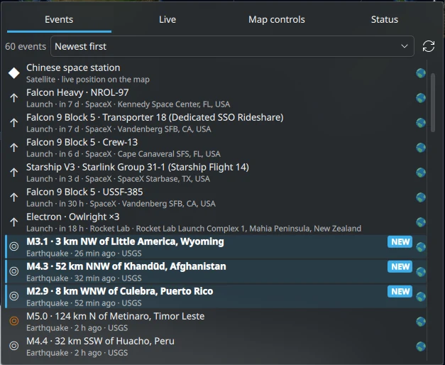
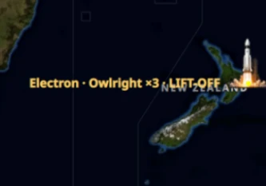

# Live World Map

A live situational-awareness wallpaper for KDE Plasma 6, with a companion panel widget.

One equirectangular world map, and on it - each layer its own tick box - the day/night line and city
lights, live clouds, earthquakes, volcanoes with their alert history, tropical storms with their track
coloured by intensity, wildfires, floods, the ISS, Hubble and Tiangong gliding along their orbits, the next rocket
launches counting down on their pads, time zones, borders, and (optionally, never leaving your machine)
where your own computer is connected to right now. Underneath the events: tectonic plate boundaries
(Earthquakes > Tectonic plates), major rivers (Rivers), state and province names, country capitals, state
capitals and cities by population (Countries > State names, Country capitals, State capitals, Cities), each
its own tick box with its own colour, size and label style.

It is built to sit on a desktop for weeks: every feed keeps its last good data and only says something when
it has been stale for hours, the clouds fall back to imagery stitched locally from five geostationary
satellites when the usual source is down, and a load guard pauses the animation - or hides the live
layers entirely - when the CPU or GPU is busy with something else, so a game or a build never fights the
wallpaper for frames.

| | |
|---|---|
|  |  |
| *Clouds off: day/night, city lights, borders and every event layer* | *Cropped to North America: storm tracks, launches and quake labels up close* |
|  |  |
| *The companion widget's Events tab: launches, quakes and storms with NEW tags and source links* | *The settings page: profile and layer switches, then one section per layer with the live state of its sources* |

### A closer look

*Tropical storms: each piece of the track takes the colour of the wind the storm had at that fix, from depression
blue through tropical-storm green to category 5 magenta. Forecast cone and points, a dot at every fix, and a ring
where the storm was first fixed.*

| | |
|---|---|
|  |   |
| *A swarm off New Caledonia: rings sized by magnitude, the strongest pulsing, and the widget listing the same quakes most severe first* | *A launch counts down on its pad, then shows lift-off for two minutes after T-0* |

## Features

| | What you get | Where it comes from |
|---|---|---|
| **Base map** | Map style: seasonal Blue Marble (NASA's monthly composites), today's satellite view (yesterday's VIIRS picture from NASA GIBS, clouds, snow and smoke as they were), Blue Marble with relief and bathymetry, dark cartographic (flat land and ocean colours of your own, no imagery), Dark Matter (greys) or Matrix (phosphor green, graticule, monospace labels, scanlines); Map tone: natural, muted, monochrome, blue-tinted or sepia; Black Marble city lights on the night side; dimming | NASA (downloaded once, ~350 MB with borders); GIBS imagery fetched for the frame on screen |
| **Framing and regions** | The whole world, without Antarctica, where people live, or a region - the Americas, North America, the United States, Central America, South America, Europe, EMEA, the Middle East, Africa, Asia, South and East Asia, South-east Asia and Oceania, Australia and New Zealand - or your own limits, Stretch / Fit / Crop. A region fills the screen with that part of the world at up to about 8x, with imagery built for exactly what is on screen, so there is room for smaller quakes, every state name and more cities. The 5 400 px monthly maps go soft past 2x: the Map section offers the 21 600 px set (Hi-res seasonal maps, about 330 MB) for sharp regions | Imagery cut from the monthly maps or fetched from NASA GIBS, by the wallpaper itself |
| **Day and night** | Terminator with twilight band, city lights glowing through the shade, recomputed locally every 2 min | Sun position, computed locally |
| **Clouds** | Live cloud cover, adjustable opacity; when the usual source is down the helper stitches its own from five geostationary satellites | live-cloud-maps (EUMETSAT); GOES-East/West, Himawari, Meteosat |
| **Geography** | *Countries*: coastlines, country borders, state and province borders (Border line colour / opacity / thickness, Detail 1:110m or 1:50m), country names (Country name density / size / text / style), state and province names (State name density / size / text / style), country capitals, state capitals and cities over 500k / 1M / 5M / 10M (each: Dot and name / Dot only / Name only, size, colour, label style; City dots sized by population). *Rivers*: major rivers and lake centrelines (River line colour / opacity / thickness). *Time zones*: zone outlines with UTC offsets, or the local time and date of each zone, summer time included, 24- or 12-hour (Time zone line colour / opacity / thickness, Time zone labels: offset / offset and local time / offset, time and date / time / time and date, Time zone style: classic labels inside each zone, one row at a latitude, D3 a band with the time large and your zone marked, D1 tinted zones like a time zone map, or both; band and tint opacity) | Natural Earth (downloaded once) |
| **Oil and gas infrastructure** | Fixed offshore platforms (squares) and refineries (triangles), off by default. Infrastructure shown: only what a storm threatens - inside its forecast cone or within 120 km of its track - drawn larger and ringed (faintly once the storm has passed), while the storm's label counts them ("14 platforms, 2 refineries in the cone · crossed 3 facilities"); or everything always. The widget lists them under the storm, what it crossed and what is in its path, facility by facility. Infrastructure threatened: named on the map with their storm (off by default). Infrastructure kinds / marks / labels / label style. Fixed structures only - mobile rigs are in no free feed | BSEE (Gulf of Mexico), OpenStreetMap (downloaded once, refresh monthly) |
| **Earthquakes** | Rings sized by magnitude (Earthquake ring colour / size, 10-250 %), Earthquake layer opacity, pulsing when new or strong (Earthquake pulse, Earthquake significance from a magnitude), labels with magnitude, place and age (Earthquake labels / label text / label style), ageing colour drift, Earthquake feed: M2.5+ day, M4.5+ day or significant week. *Tectonic plates*: the plate boundaries as fault lines (Tectonic line colour / opacity / thickness) | USGS, every 5 min; PB2002 plate model (downloaded once) |
| **Volcanoes** | Hollow triangles coloured by alert level (yellow / orange / red), pulse on first report or level change, label with how long above normal | Smithsonian GVP eruption database and weekly report, USGS HANS, hourly |
| **Tropical storms** | NHC-style cyclone icon with category number, past track and forecast coloured by intensity at each fix (depression to category 5), forecast cone, first-fix marker; storms keep their identity across sources and age out instead of vanishing. Storm labels: name / name and wind / name, type and wind, with the facilities it threatens on a line of their own (Storm label facilities); Storm layer opacity for the icon, track and cone as a whole | GDACS worldwide; NOAA NHC best track and forecast for the Atlantic and Pacific, every 30 min |
| **Wildfires** | GDACS events as flames sized by burned area, plus MODIS hotspots clustered into half-degree cells and sized by fire power; Wildfire focus: near people (orange / red events and hotspots within 50 km of a city of 100 000 - the default, so the seasonal burning of the savannas does not cover the map), orange and red only, or everything; level and size filters | GDACS, NASA FIRMS, hourly |
| **Floods** | GDACS flood events as a wave mark coloured by alert level, the affected districts as a faint fill, labelled with what happened to people (dead, evacuated, displaced) and how long the flood has run; orange and red only by default, since GDACS always lists a dozen green basins at seasonal high water. US flood alerts from the National Weather Service join the same layer minutes after issue: flash flood warnings (red), flood warnings (orange), watches (green), with the counties, the end time and the warning polygon or forecast zones as the area | GDACS, hourly; NWS, every 10 min |
| **Spacecraft** | ISS, Hubble and Tiangong as pictures or symbols moving once a second along a fading ground track (30 min, one or two orbits ahead), altitude in km, mi or nmi | CelesTrak elements, propagated locally (Kepler + J2) |
| **Rocket launches** | Rocket on its pad with a live countdown; last ten minutes in mm:ss with a growing amber label, "LIFT-OFF" then a lift-off picture; the mission on a line of its own (Launch label mission); Launch layer opacity | The Space Devs Launch Library 2, hourly |
| **Network activity** *(off by default)* | Arcs from your home city to every host this machine is connected to, animated packets, kernel round-trip times, first-time places highlighted, closed connections fading out; nothing leaves the machine | Local sockets via `ss`, DB-IP Lite offline geolocation, every 10 s |
| **Labels** | One layout pass above every layer: real-width overlap avoidance, flip to the free side, leader lines, plates and per-type text colours, one-line / two-line / automatic | - |
| **Life cycle** | Every event pulses while newly reported, sits steady while listed, then drifts to an aged colour and is removed; a change of status counts as new again | Helper memory (`events.json`) |
| **Resilience** | Every feed keeps its last good data; a desktop notice only after a source has been stale for hours; HTTPS only, size-capped, parsed as data, rendered as plain text | - |
| **Performance and power** | High performance / Balanced / Power saving profiles; 10-60 animation updates a second, stopped when idle; the still map cached as one texture; load guard pauses animation or unloads live layers when CPU or GPU is busy; on-battery policy | sysfs / nvidia-smi / CPU, polled every 20 s |
| **Companion widget** | Newest events with source links, sorted by time, severity, kind or "what is next", NEW / SOON / LIVE tags; ISS and launch webcasts embedded, in mpv or in the browser; map controls (pause, plain map, hide layers, clouds on/off and opacity, full speed on demand for a set time); status of every data source; lists only the kinds the wallpaper shows; a notification sound (pop, chime, zing or your own file) for severe events and imminent launches | Shares the wallpaper's helper and caches |
| **Command line** | `livemap.sh` doctor / install / activate / deactivate / remove / purge / status, with per-distro install hints for Fedora, Arch, openSUSE and Debian/Ubuntu/neon | - |

## Install

Requirements: KDE Plasma 6 on Linux, Python 3.9 or newer, and the QML modules Plasma normally ships with.
`livemap.sh doctor` checks every one of them and prints the exact packages to install for Fedora, Arch,
openSUSE and Debian/Ubuntu/KDE neon; `install` refuses to continue while a required one is missing.

Download `livemap.zip` from the latest release, then:

    bash livemap.sh doctor                          # what is missing, if anything
    bash livemap.sh install ~/Downloads/livemap.zip
    bash livemap.sh activate                        # make it the wallpaper on every desktop

The install restarts plasmashell so the new settings page is there at once. The widget is under *Add
Widgets* as **Live World Map Events**.

### First run: the downloads

Nothing is bundled but the code, so the map starts as a dark Earth with the live layers on it and a note in
the corner saying what is missing. Right-click the desktop > *Configure Desktop and Wallpaper*; every
section that needs a download has a **Download** button on its source line (and a green dot once it is
there). In the order you will want them:

| Download | Where | Size | What it gives you |
|---|---|---|---|
| Seasonal maps and city lights | Map | 35 MB | NASA's 12 monthly Blue Marble images and the Black Marble night picture - the base map and the city lights |
| Border data | Countries | 12 MB | Coastlines, borders, rivers, country and state names, capitals and cities, time zones, plate boundaries - everything vector |
| Hi-res seasonal maps | Map | 330 MB | The 21 600 px monthly set; only worth it for a region (Map > Show) or a 5K screen |
| Oil and gas infrastructure | Oil and gas infrastructure | a few MB | Offshore platforms and refineries; off by default |
| GeoIP database | Network activity | 20 MB | Offline geolocation for the Network layer; off by default |

The other map styles (today's satellite view, relief, dark cartographic, Dark Matter, Matrix) build their
own imagery for whatever is on screen when you choose them - a few seconds, a few MB, with a note in the
corner while they do.

Everything is per user and nothing runs in the background: the wallpaper is QML inside plasmashell, and the
helper is a Python script (standard library only) that runs for a few seconds per fetch.

Optional packages, each named by `doctor`: `python3-pillow` (the map styles other than seasonal, the
region imagery, the time zone tint, faster cloud stitching), `python3-numpy` (city lights extraction),
`python3-maxminddb` (the Network layer), QtWebEngine (embedded ISS and launch streams in the widget), and
`pw-play` / `paplay` for the widget's notification sound (one of them is on any PipeWire or PulseAudio desktop).

### Where things live

| What | Where |
|---|---|
| The wallpaper package | `~/.local/share/plasma/wallpapers/io.github.tidybitz.livemap.wallpaper/` |
| The widget package | `~/.local/share/plasma/plasmoids/io.github.tidybitz.livemap.events/` |
| The helper | `.../livemap.wallpaper/contents/helper/livemap-helper.py` - also what `livemap-helper` runs from a terminal |
| Downloads and caches | `~/.local/share/livemap/` (`$XDG_DATA_HOME/livemap`): `base/` the monthly maps, `borders/` Natural Earth and PB2002, `frames/` imagery built per view and style (safe to delete; rebuilt on demand), `night.jpg` / `lights.png`, `infrastructure.json`, the feed caches (`last-*.json`), the event memory (`events.json`, `history.json`, `hotspot-days.json`), the widget's overrides (`mode.json`, `layers.json`), and your saved styles (`styles/*.json`, `styles/original.json` from before styles were first used, `styles/history/` the snapshots taken before every apply) |
| Your settings | Plasma's own: `~/.config/plasma-org.kde.plasma.desktop-appletsrc` for the wallpaper (per screen and per Activity, so each monitor can have its own layers), the widget's in the same file under its applet |
| Logs | `journalctl --user -f \| grep -i livemap` - the wallpaper logs what it loads, draws and fails to fetch |

`livemap.sh remove` uninstalls the packages and leaves the data folder; `purge` deletes that and the settings too.

## The script

    livemap.sh doctor [--report]         check every dependency; --report adds versions, GPU, logs for a bug report
    livemap.sh install [livemap.zip]     check, then install or update the wallpaper and the widget
    livemap.sh activate | deactivate     switch every desktop to the map / back to the stock image
    livemap.sh remove                    deactivate, remove the widget from panels, uninstall both packages
    livemap.sh purge [--yes]             remove, then delete the data folder and the saved settings
    livemap.sh status                    what is installed, active, running and stored
    livemap.sh help [command]

## Layers and sources

| Layer | Source | Refresh |
|---|---|---|
| Base map, seasons, city lights | NASA Blue Marble Next Generation, Black Marble (downloaded once) | monthly blend, computed locally |
| Today's satellite view, relief and bathymetry | NASA GIBS (VIIRS SNPP corrected reflectance; Blue Marble shaded relief and bathymetry), WMS, no key | daily / once per frame |
| Day / night, twilight | computed locally from the sun's position | every 2 min |
| Clouds | Matt Eason's live-cloud-maps (EUMETSAT); fallback stitched from GOES-East/West, Himawari (NASA GIBS) and Meteosat (EUMETView) | every 3 h |
| Coastlines, country and state borders, rivers, country and state names, capitals and cities, time zones | Natural Earth 1:110m and 1:50m vectors, admin-1 label points, populated places (downloaded once, about 12 MB) | - |
| Earthquakes | USGS Earthquake Hazards Program | every 5 min |
| Tectonic plate boundaries | PB2002 plate boundary model (Peter Bird 2003; GeoJSON by Hugo Ahlenius / Nordpil, ODC-By), downloaded with the borders (0.2 MB) | - |
| Oil and gas infrastructure | BSEE platform structures (US Gulf of Mexico, public domain); OpenStreetMap offshore platforms and refineries via Overpass (ODbL, (c) OpenStreetMap contributors); downloaded on demand | - |
| Volcanoes | Smithsonian Global Volcanism Program (eruption database, weekly report), USGS alert levels (HANS) | hourly |
| Storms | GDACS worldwide; NOAA NHC for current intensity, best track and forecast in the Atlantic and Pacific | every 30 min |
| Wildfires | GDACS events, NASA FIRMS hotspots (MODIS) | hourly |
| Floods | GDACS events, their Sendai figures and affected-area polygons | hourly |
| US flood alerts | NWS api.weather.gov active alerts; forecast-zone polygons cached in `nws-zones/` | every 10 min |
| ISS, Hubble, Tiangong | CelesTrak orbital elements, propagated locally (Kepler + J2) | position every second |
| Launches | The Space Devs, Launch Library 2 | hourly |
| Network (off by default) | this machine's sockets, DB-IP Lite geolocation, all local | every 10 s |

Every source is fetched over HTTPS only, capped in size, parsed as data and never executed; strings that end
up on the desktop are filtered and rendered as plain text. The data folder is `~/.local/share/livemap`.

## Companion widget

**Live World Map Events** lists the newest events with links to their sources (sorted by time, severity, kind
or "what is next"; NEW / SOON / LIVE tags), embeds or opens the ISS and launch webcasts, controls the map
(pause, plain map, hide layers, clouds on/off and opacity, and "full speed" to set aside the battery policy
and load guard for an hour or a few) and shows the status of every data source. By default it lists only the
kinds of event the wallpaper is showing (Events listed: only the kinds the wallpaper shows). It can play a
sound - a bubble pop, a chime, a zing, or a file of your own - when a severe event arrives (a magnitude 6+
quake, a category 3+ storm, a red alert) or a launch is in its last minutes (Notification sound). It uses the
wallpaper's helper and caches; nothing is fetched twice.

## Repository layout

    livemap/                     the wallpaper package (Plasma/Wallpaper)
      metadata.json                id, name, version
      contents/ui/
        main.qml                   the map: framing, the still layer (imagery, clouds, night, lights) and one Loader per live layer
        *Layer.qml                 one file per layer (Quake, Storm, Volcano, Fire, Sat, Launch, Net, Border, Plate, Infra)
        LabelPass.qml, MapLabel.qml, HaloText.qml   one label layout pass above every layer, and the label itself
        FrameWatch.qml, PowerWatch.qml, CloudWatch.qml   small watchers that run the helper: imagery per view, power and load, clouds
        config.qml, StatusPanel.qml   the settings page and its Status section
        Look.qml                   the appearance singleton (the Matrix style's font and glow)
        geo.js                     the maths: sun position, label placement, projections, ageing
      contents/helper/livemap-helper.py   every fetch, cache and calculation the QML cannot do; `livemap-helper --help`
      contents/config/main.xml   one <entry> per setting; scripts/check.py keeps it in step with config.qml
      contents/images/           spacecraft, launch-pad and storm icons (CC BY 4.0)
      contents/styles/*.json     the built-in styles: each base map's recommended colours as the keys that differ from main.xml
    livemap-widget/              the companion widget package (Plasma/Applet)
      contents/ui/main.qml         the Events, Live, Map controls and Status tabs
      contents/ui/configGeneral.qml   its settings page
      contents/icons/, contents/sounds/   the flame and satellite icons; the three notification sounds
    livemap.sh                   install / doctor / activate / remove / purge / status
    scripts/check.py             static checks (settings <-> config page, brackets, ids, versions); CI runs it
    scripts/package.sh           builds livemap.zip
    .github/                     CI (checks on every push; a release on every v* tag), Dependabot, the bug template
    docs/screenshots/            the pictures in this README
    CHANGELOG.md                 every release, newest first

Adding a layer: a new `FooLayer.qml`, an `<entry name="ShowFoo">` in main.xml, a `cfg_ShowFoo` alias and a
section in config.qml, and a `Loader` in main.qml. Layers exist only while ticked. The wallpaper and the
helper talk through JSON on stdout: a layer runs `livemap-helper foo` through a `P5Support.DataSource` and
parses the answer; the helper never writes to the map. `livemap/README.md` has the developer notes (how
the day/night shade avoids a shader, the `layer` id trap, and so on).

## If something does not show up

    bash livemap.sh doctor --report                       # dependencies, versions, the helper's status, last log lines
    journalctl --user -f | grep -i -E "livemap|qml"      # QML errors as they happen
    livemap-helper status | python3 -m json.tool          # the health report the settings page shows

Please open an issue with the output of `livemap.sh doctor --report`. Pull requests: see [CONTRIBUTING.md](CONTRIBUTING.md);
security issues: [SECURITY.md](SECURITY.md).

## Licence

GNU General Public License v3.0 or later - see [LICENSE](LICENSE). The storm icon set and the spacecraft
and launch-pad pictures are by tidybitz, CC BY 4.0. Copyright (C) 2026 tidybitz.

## Credits

NASA Earth Observatory (Blue Marble Next Generation, Black Marble 2016) · Made with Natural Earth · Plate boundaries: PB2002,
Peter Bird (2003), GeoJSON by Hugo Ahlenius / Nordpil (github.com/fraxen/tectonicplates, ODC-By) ·
USGS Earthquake Hazards Program · Smithsonian Institution Global Volcanism Program · USGS Volcano Hazards
Program (HANS) · Global Disaster Alert and Coordination System (GDACS) · NOAA National Hurricane Center ·
NASA FIRMS (MODIS, LANCE/EOSDIS) · CelesTrak · The Space Devs (Launch Library 2) · Matt Eason's
live-cloud-maps (EUMETSAT data) · NASA GIBS (GOES, Himawari) · EUMETSAT EUMETView (Meteosat) ·
IP Geolocation by DB-IP (https://db-ip.com, CC BY 4.0) · issinfo.net (who is in space) · BSEE / BOEM platform
structures · (c) OpenStreetMap contributors, ODbL (offshore platforms, refineries).
