# Live World Map

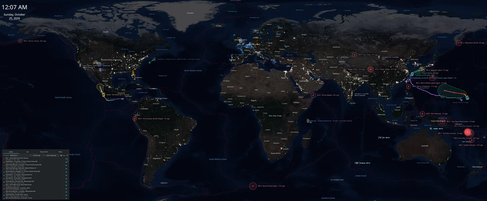

A live situational-awareness wallpaper for KDE Plasma 6, with a companion desktop widget.

One equirectangular world map, and on it - each layer its own switch - the day/night line and city lights
(or the whole map at night, by the clock or always), live clouds, earthquakes, volcanoes with their alert levels
and ash advisories, tropical storms with their track coloured by intensity and a forecast cone for every one,
wildfires, floods and official flood warnings on four continents, tsunami bulletins, Ukraine's air raid alerts,
the ISS, Hubble and Tiangong gliding along their orbits with their crews listed, the next rocket launches
counting down on their pads, time zones, borders, rivers, lakes and seas, and (optionally, never leaving your
machine) where your own computer is connected to right now.

It is built to sit on a desktop for weeks: every feed keeps its last good data and only says something when it
has been stale for hours, the clouds fall back to imagery stitched locally from five geostationary satellites
when the usual source is down, a load guard pauses the animation - or hides the live layers entirely - when the
CPU or GPU is busy, and a daily probe on GitHub asks every source whether it still answers.

| | |
|---|---|
| 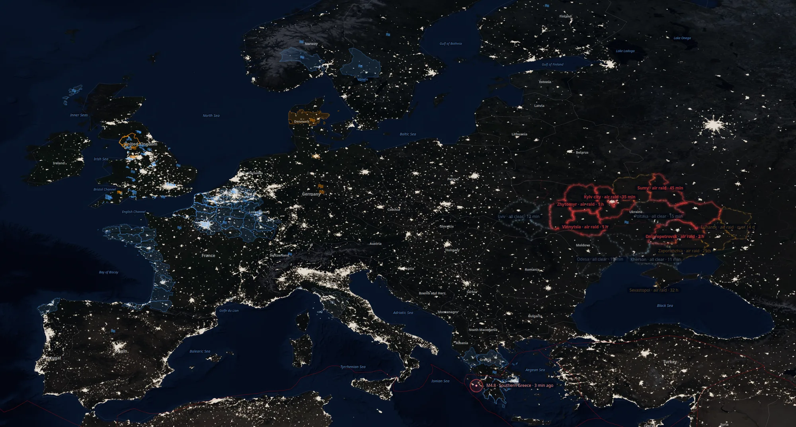 | 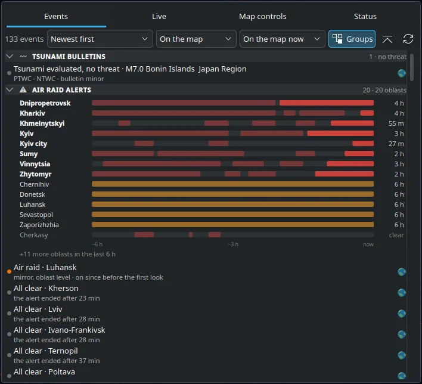 |
| *Air raid alerts as edge lights: a new alert breathes brightest red, settled ones hold a steady edge, the frontline's long-running ones drop to ochre, all-clears fade in cool blue - the city lights inside stay* | *The widget: under the Air raid alerts header, one row per oblast for the last six hours - a bar for every alert, newest on the right* |
| 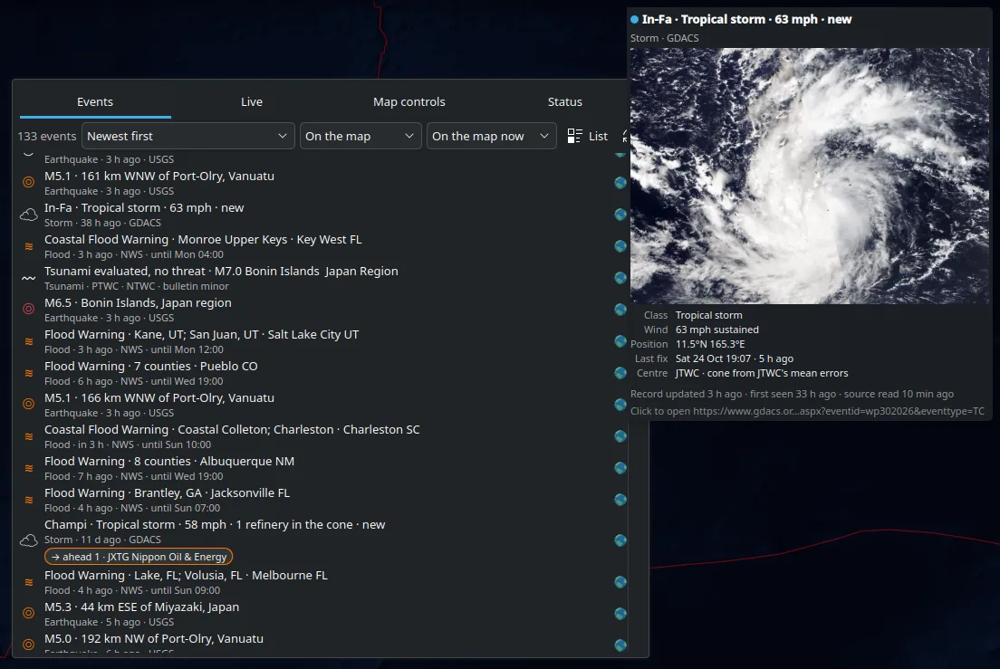 | 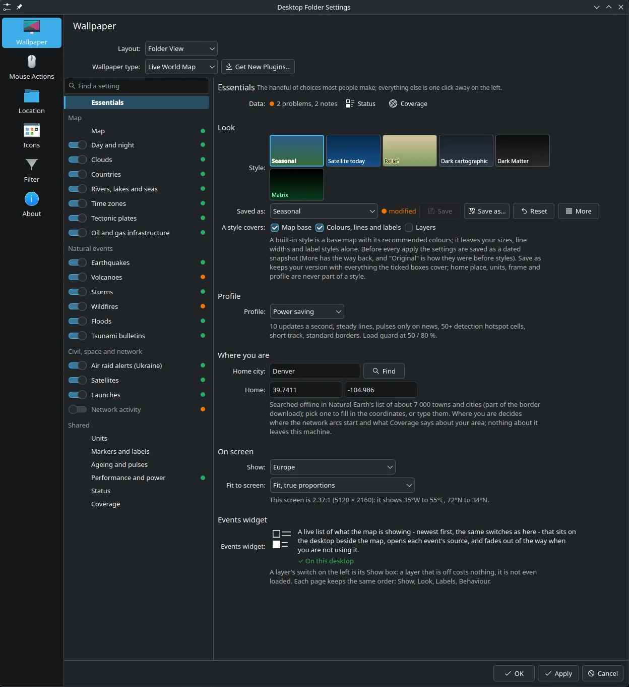 |
| *Rest the pointer on an event and a bubble says what the feed knows - here In-Fa, with NASA's latest satellite pass, winds, position, the last fix and when the record changed* | *Settings: a sidebar with a switch and a health dot per layer, Essentials first - style, profile, home, framing and the widget* |

### Space

| | |
|---|---|
|  | 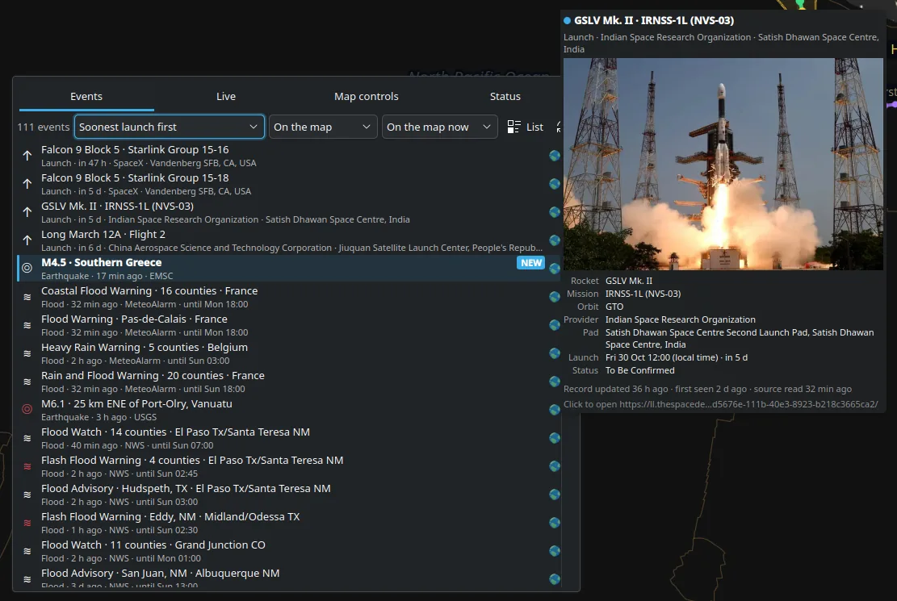 |
| *The ISS right now: where it is, how high and how fast, and the seven people aboard - flag, agency's country and days in space* | *A launch five days out: GSLV Mk. II with its picture, the mission, orbit, pad, local launch time and status; the widget sorted soonest launch first* |

### Styles

| | |
|---|---|
| 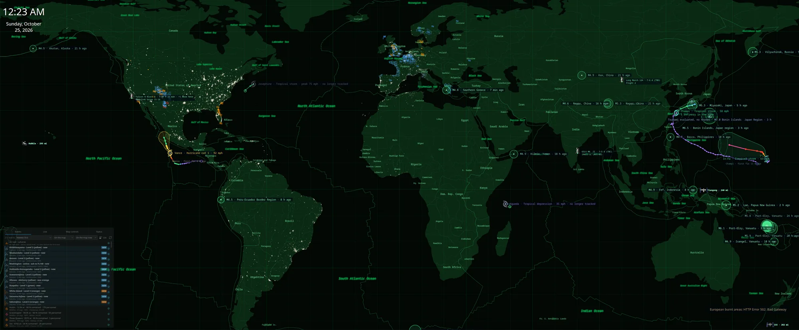 |  |
| *Matrix: phosphor green, a scanline, monospaced labels* | *Dark cartographic: your own land and ocean colours, the events in theirs* |
|  |  |
| *Dark Matter: greys, the city lights the only colour besides the events* | *Classic Blue Marble: NASA's 2002 composite at 5 400 px, the night side and city lights over it, typhoon In-Fa and tropical storms Vance, Otona and Champi on their tracks* |
| 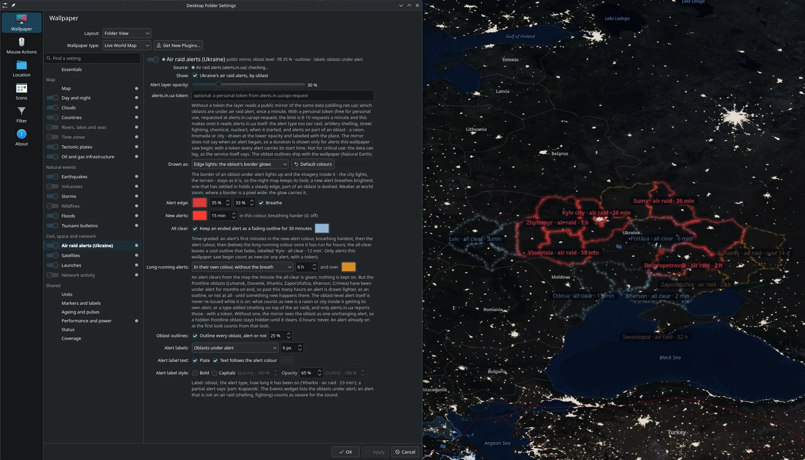 | |
| *The alert edges up close: new brightest, settled steady, frontline ochre, all-clear fading blue* | |

### A closer look

| | |
|---|---|
| 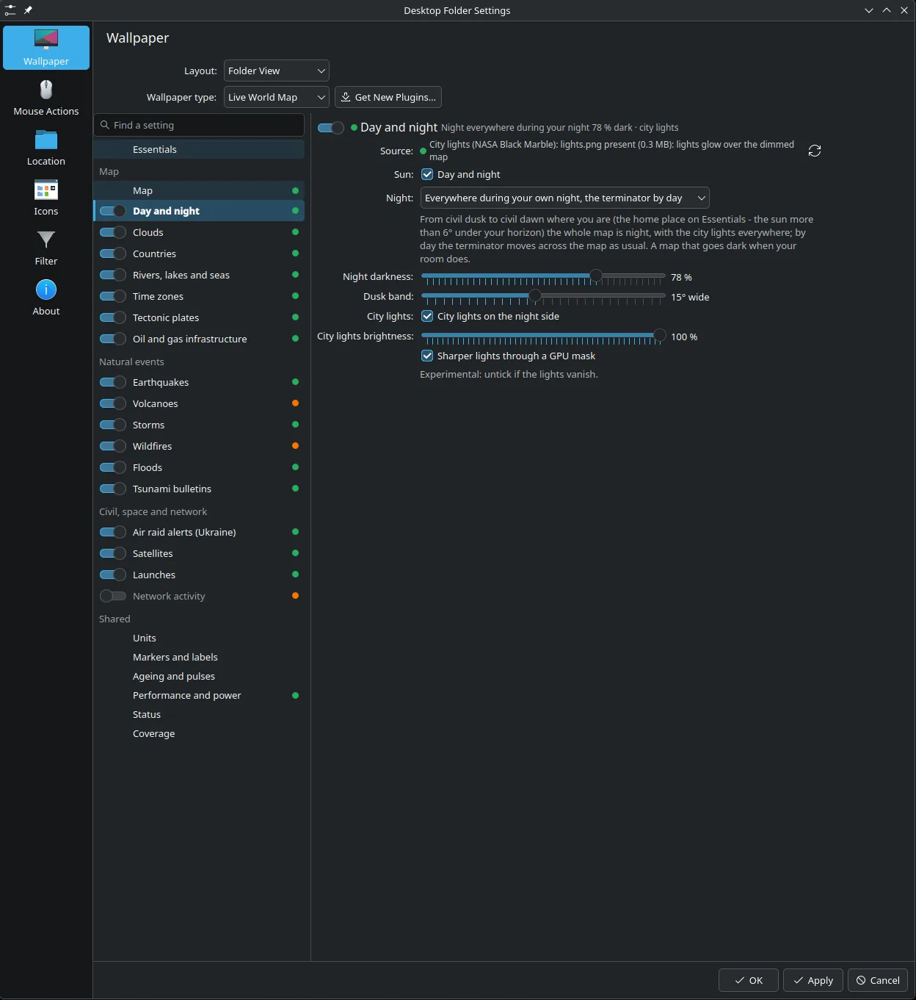 | 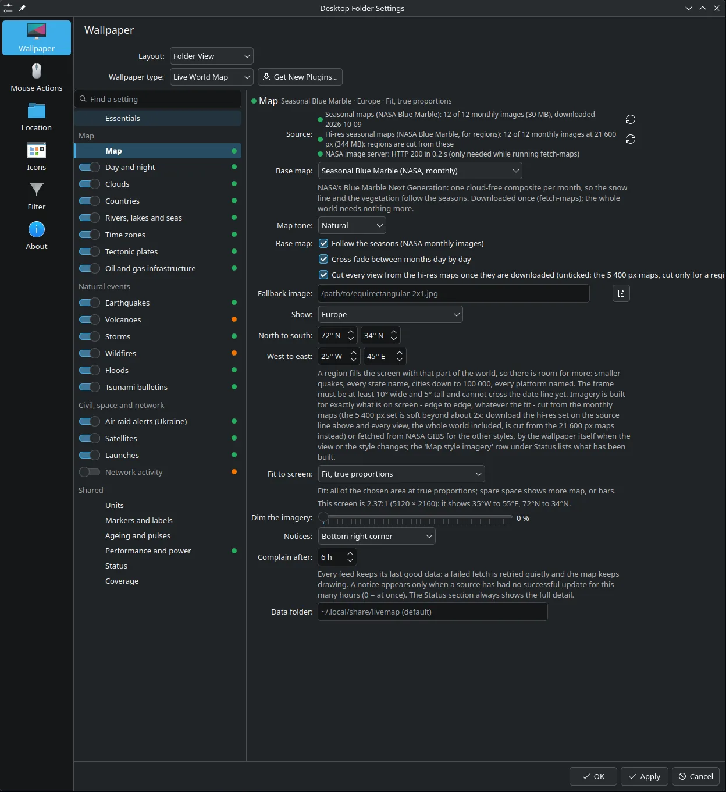 |
| *Night: the terminator, everywhere always, or everywhere during your own night* | *Map: base map, the region on screen, and how it is fitted; a banner shows the imagery being built after Apply* |
| 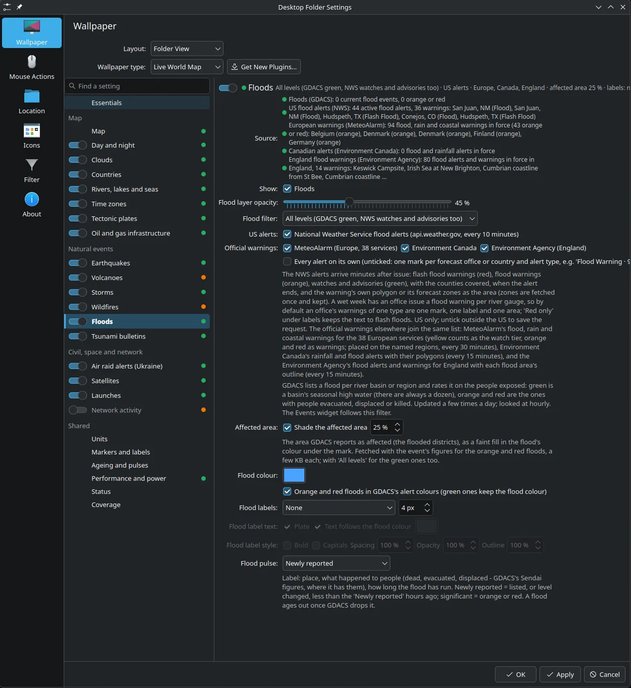 | 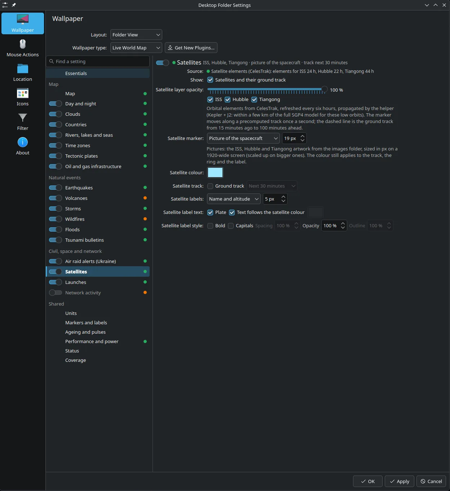 |
| *Storms: GDACS, NHC and JTWC; icon set, intensity colours, cones for every storm, facilities in the cone* | *Air raid alerts: edge lights or fills, the red-first palette, long-running alerts in their own colour or hidden until something new happens* |

| | |
|---|---|
| 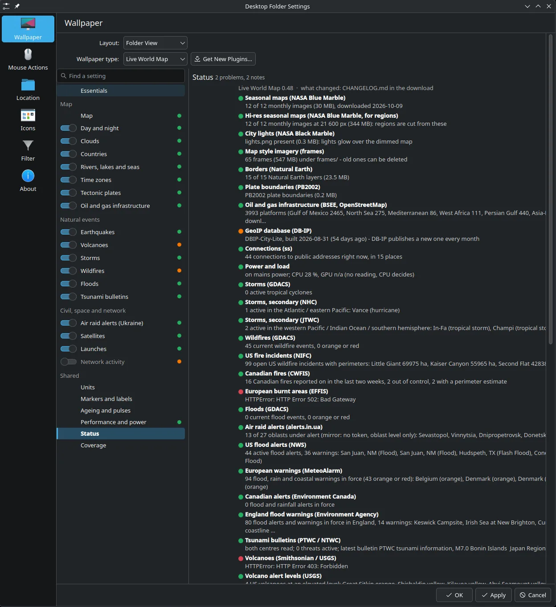 | 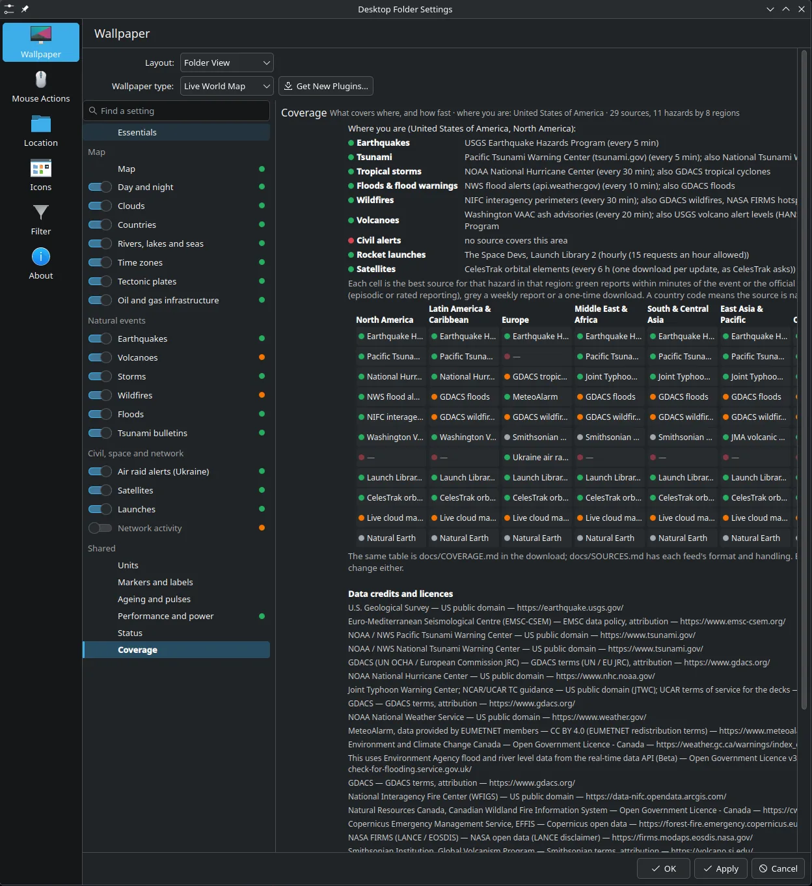 |
| *Status: every source and local file, green/orange/red, with what it answered - the same list the widget's Map controls tab shows under Sources* | *Coverage: which source covers each hazard in each region and how fast, your own area first, then every provider's licence* |

Older pictures (0.46: the collapsible settings, the storm tracks page, US floods, launches) are in
[docs/screenshots/v0.46](docs/screenshots/v0.46).

## Features

| | What you get | Where it comes from |
|---|---|---|
| **Base map** | Map style: seasonal Blue Marble (NASA's monthly composites), today's satellite view (yesterday's VIIRS picture from NASA GIBS, clouds, snow and smoke as they were), Blue Marble with relief and bathymetry, dark cartographic (flat land and ocean colours of your own, no imagery), Dark Matter (greys) or Matrix (phosphor green, graticule, monospace labels, scanlines); Map tone: natural, muted, monochrome, blue-tinted or sepia; Black Marble city lights on the night side; dimming | NASA (downloaded once, ~350 MB with borders); GIBS imagery fetched for the frame on screen |
| **Framing and regions** | The whole world, without Antarctica, where people live, or a region - the Americas, North America, the United States, Central America, South America, Europe, EMEA, the Middle East, Africa, Asia, South and East Asia, South-east Asia and Oceania, Australia and New Zealand - or your own limits; Auto fit (stretch up to 12 %, then crop, so a laptop panel never gets tall continents), Stretch, Fit, Crop or Fill. A region fills the screen with that part of the world at up to about 8x, with imagery built for exactly what is on screen, so there is room for smaller quakes, every state name and more cities. The 5 400 px monthly maps go soft past 2x: the Map section offers the 21 600 px set (Hi-res seasonal maps, about 330 MB) for sharp regions | Imagery cut from the monthly maps or fetched from NASA GIBS, by the wallpaper itself |
| **Day and night** | Terminator with twilight band, city lights glowing through the shade, recomputed locally every 2 min | Sun position, computed locally |
| **Clouds** | Live cloud cover, adjustable opacity; when the usual source is down the helper stitches its own from five geostationary satellites | live-cloud-maps (EUMETSAT); GOES-East/West, Himawari, Meteosat |
| **Geography** | *Countries*: coastlines, country borders, state and province borders (Border line colour / opacity / thickness, Detail 1:110m or 1:50m), country names (Country name density / size / text / style), state and province names (State name density / size / text / style), country capitals, state capitals and cities over 500k / 1M / 5M / 10M (each: Dot and name / Dot only / Name only, size, colour, label style; City dots sized by population). *Rivers*: major rivers and lake centrelines (River line colour / opacity / thickness). *Time zones*: zone outlines with UTC offsets, or the local time and date of each zone, summer time included, 24- or 12-hour (Time zone line colour / opacity / thickness, Time zone labels: offset / offset and local time / offset, time and date / time / time and date, Time zone style: classic labels inside each zone, one row at a latitude, D3 a band with the time large and your zone marked, D1 tinted zones like a time zone map, or both; band and tint opacity) | Natural Earth (downloaded once) |
| **Oil and gas infrastructure** | Fixed offshore platforms (squares) and refineries (triangles), off by default. Infrastructure shown: only what a storm threatens - inside its forecast cone or within 120 km of its track - drawn larger and ringed (faintly once the storm has passed), while the storm's label counts them ("14 platforms, 2 refineries in the cone · crossed 3 facilities"); or everything always. The widget lists them under the storm, what it crossed and what is in its path, facility by facility. Infrastructure threatened: named on the map with their storm (off by default). Infrastructure kinds / marks / labels / label style. Fixed structures only - mobile rigs are in no free feed | BSEE (Gulf of Mexico), OpenStreetMap (downloaded once, refresh monthly) |
| **Earthquakes** | Rings sized by magnitude (Earthquake ring colour / size, 10-250 %), Earthquake layer opacity, pulsing when new or strong (Earthquake pulse, Earthquake significance from a magnitude), labels with magnitude, place and age (Earthquake labels / label text / label style), ageing colour drift, Earthquake feed: M2.5+ day, M4.5+ day or significant week. *Tectonic plates*: the plate boundaries as fault lines (Tectonic line colour / opacity / thickness) | USGS, every 5 min; PB2002 plate model (downloaded once) |
| **Volcanoes** | Hollow triangles coloured by alert level (yellow / orange / red), pulse on first report or level change, label with how long above normal | Smithsonian GVP eruption database and weekly report, USGS HANS, hourly |
| **Tropical storms** | NHC-style cyclone icon with category number, past track and forecast coloured by intensity at each fix (depression to category 5), forecast cone, first-fix marker; storms keep their identity across sources and age out instead of vanishing. Storm labels: name / name and wind / name, type and wind, with the facilities it threatens on a line of their own (Storm label facilities); Storm layer opacity for the icon, track and cone as a whole | GDACS worldwide; NOAA NHC best track and forecast for the Atlantic and eastern Pacific, JTWC for the western Pacific, Indian Ocean and southern hemisphere, every 30 min |
| **Wildfires** | The fires the agencies are fighting, by name, with size, containment or stage of control, personnel, and the mapped perimeter as a faint fill: NIFC interagency perimeters (US), CWFIS active fires with satellite perimeter estimates (Canada), EFFIS burnt areas (Europe, Middle East, North Africa); GDACS events for the rest of the world as flames by alert level; NASA FIRMS hotspots optional (off by default, clustered and rated so a burning season does not cover the map). Sources are a set; size and "not yet contained" filters | NIFC, CWFIS, EFFIS every 30 min; GDACS, FIRMS hourly |
| **Tsunami bulletins** | Every large undersea earthquake the Pacific and National Tsunami Warning Centers evaluate, as a ringed mark at the epicentre coloured by the level - no threat found, watch, advisory, warning or threat message - with rings running out while a threat stands and the threatened coast drawn between the centres' breakpoints; a threat stood down by a later message fades out. The widget lists them first | tsunami.gov CAP (PTWC, NTWC), every 5 min |
| **Floods** | GDACS flood events as a wave mark coloured by alert level, the affected districts as a faint fill, labelled with what happened to people (dead, evacuated, displaced) and how long the flood has run; orange and red only by default, since GDACS always lists a dozen green basins at seasonal high water. US flood alerts from the National Weather Service join the same layer minutes after issue: flash flood warnings (red), flood warnings (orange), watches (green), with the counties, the end time and the warning polygon or forecast zones as the area | GDACS, hourly; NWS, every 10 min |
| **Air raid alerts** | Ukraine's civil air-raid alerts by oblast: the region fills in the alert colour while an alert is on, breathing slowly, lower opacity for part of an oblast, every oblast outlined faintly; labelled with the alert type and how long it has been on. Without a token: a public mirror, air raid only; with a free personal token from alerts.in.ua: alert types, partial alerts, start times | alerts.in.ua / mirror, every minute |
| **Spacecraft** | ISS, Hubble and Tiangong as pictures or symbols moving once a second along a fading ground track (30 min, one or two orbits ahead), altitude in km, mi or nmi | CelesTrak elements, propagated locally (Kepler + J2) |
| **Rocket launches** | Rocket on its pad with a live countdown; last ten minutes in mm:ss with a growing amber label, "LIFT-OFF" then a lift-off picture; the mission on a line of its own (Launch label mission); Launch layer opacity | The Space Devs Launch Library 2, hourly |
| **Network activity** *(off by default)* | Arcs from your home city to every host this machine is connected to, animated packets, kernel round-trip times, first-time places highlighted, closed connections fading out; nothing leaves the machine | Local sockets via `ss`, DB-IP Lite offline geolocation, every 10 s |
| **Labels** | One layout pass above every layer: real-width overlap avoidance, flip to the free side, leader lines, plates and per-type text colours, one-line / two-line / automatic | - |
| **Life cycle** | Every event pulses while newly reported, sits steady while listed, then drifts to an aged colour and is removed; a change of status counts as new again | Helper memory (`events.json`) |
| **Resilience** | Every feed keeps its last good data; a desktop notice only after a source has been stale for hours; HTTPS only, size-capped, parsed as data, rendered as plain text | - |
| **Performance and power** | High performance / Balanced / Power saving profiles; 10-60 animation updates a second, stopped when idle; the still map cached as one texture; load guard pauses animation or unloads live layers when CPU or GPU is busy; on-battery policy | sysfs / nvidia-smi / CPU, polled every 20 s |
| **Companion widget** | Newest events with source links, sorted by time, severity, kind or "what is next", NEW / SOON / LIVE tags; ISS and launch webcasts embedded, in mpv or in the browser; hover a row and its event is ringed on the map (an arrow from the edge when it is off screen); a Sky tab for the home place (now, seven day strips with hour-by-hour temperature, night, rain and snow, a now line and a hover bubble, sun and moon, tonight's cloud, the next visible ISS pass, aurora and air quality, each source with its age); map controls (pause, plain map, hide layers, clouds on/off and opacity, full speed on demand for a set time) with the status of every data source underneath; lists only the kinds the wallpaper shows; a notification sound (pop, chime, zing or your own file) for severe events and imminent launches | Shares the wallpaper's helper and caches |
| **Command line** | `livemap.sh` doctor / install / activate / deactivate / remove / purge / status, with per-distro install hints for Fedora, Arch, openSUSE and Debian/Ubuntu/neon | - |

## Install

Requirements: KDE Plasma 6 on Linux, Python 3.9 or newer, and the QML modules Plasma normally ships with.
`livemap.sh doctor` checks every one of them and prints the exact packages to install for Fedora, Arch,
openSUSE and Debian/Ubuntu/KDE neon; `install` refuses to continue while a required one is missing.

Download `livemap.zip` from the latest release, then:

    bash livemap.sh doctor                          # what is missing, if anything
    bash livemap.sh install ~/Downloads/livemap.zip
    bash livemap.sh activate                        # make it the wallpaper on every desktop

The install restarts plasmashell so the new settings page is there at once. The widget is under *Add
Widgets* as **Live World Map Events**.

### First run: the downloads

Nothing is bundled but the code, so the map starts as a dark Earth with the live layers on it and a note in
the corner saying what is missing. Right-click the desktop > *Configure Desktop and Wallpaper*; every
section that needs a download has a **Download** button on its source line (and a green dot once it is
there). In the order you will want them:

| Download | Where | Size | What it gives you |
|---|---|---|---|
| Seasonal maps and city lights | Map | 35 MB | NASA's 12 monthly Blue Marble images and the Black Marble night picture - the base map and the city lights |
| Border data | Countries | 12 MB | Coastlines, borders, rivers, country and state names, capitals and cities, time zones, plate boundaries - everything vector |
| Hi-res seasonal maps | Map | 330 MB | The 21 600 px monthly set; only worth it for a region (the frame on Essentials) or a 5K screen |
| Oil and gas infrastructure | Oil and gas infrastructure | a few MB | Offshore platforms and refineries; off by default |
| GeoIP database | Network activity | 20 MB | Offline geolocation for the Network layer; off by default |

The other map styles (today's satellite view, relief, dark cartographic, Dark Matter, Matrix) build their
own imagery for whatever is on screen when you choose them - a few seconds, a few MB, with a note in the
corner while they do.

Everything is per user and nothing runs in the background: the wallpaper is QML inside plasmashell, and the
helper is a Python script (standard library only) that runs for a few seconds per fetch.

Optional packages, each named by `doctor`: `python3-pillow` (the map styles other than seasonal, the
region imagery, the time zone tint, faster cloud stitching), `python3-numpy` (city lights extraction),
`python3-maxminddb` (the Network layer), QtWebEngine (embedded ISS and launch streams in the widget), and
`pw-play` / `paplay` for the widget's notification sound (one of them is on any PipeWire or PulseAudio desktop).

### Where things live

| What | Where |
|---|---|
| The wallpaper package | `~/.local/share/plasma/wallpapers/io.github.tidybitz.livemap.wallpaper/` |
| The widget package | `~/.local/share/plasma/plasmoids/io.github.tidybitz.livemap.events/` |
| The helper | `.../livemap.wallpaper/contents/helper/livemap-helper.py` - also what `livemap-helper` runs from a terminal |
| Downloads and caches | `~/.local/share/livemap/` (`$XDG_DATA_HOME/livemap`): `base/` the monthly maps, `borders/` Natural Earth and PB2002, `frames/` imagery built per view and style (safe to delete; rebuilt on demand), `night.jpg` / `lights.png`, `infrastructure.json`, the feed caches (`last-*.json`), the event memory (`events.json`, `history.json`, `hotspot-days.json`), the widget's overrides (`mode.json`, `layers.json`), and your saved styles (`styles/*.json`, `styles/original.json` from before styles were first used, `styles/history/` the snapshots taken before every apply) |
| Your settings | Plasma's own: `~/.config/plasma-org.kde.plasma.desktop-appletsrc` for the wallpaper (per screen and per Activity, so each monitor can have its own layers), the widget's in the same file under its applet |
| Logs | `journalctl --user -f \| grep -i livemap` - the wallpaper logs what it loads, draws and fails to fetch |

`livemap.sh remove` uninstalls the packages and leaves the data folder; `purge` deletes that and the settings too.

## The script

    livemap.sh doctor [--report]         check every dependency; --report adds versions, GPU, logs for a bug report
    livemap.sh install [livemap.zip]     check, then install or update the wallpaper and the widget; run from a
                                         source checkout it does git pull first and installs the folders as pulled
    livemap.sh activate | deactivate     switch every desktop to the map / back to the stock image
    livemap.sh remove                    deactivate, remove the widget from panels, uninstall both packages
    livemap.sh purge [--yes]             remove, then delete the data folder and the saved settings
    livemap.sh status                    what is installed, active, running and stored
    livemap.sh help [command]

## Layers and sources

| Layer | Source | Refresh |
|---|---|---|
| Base map, seasons, city lights | NASA Blue Marble Next Generation, Black Marble (downloaded once) | monthly blend, computed locally |
| Today's satellite view, relief and bathymetry | NASA GIBS (VIIRS SNPP corrected reflectance; Blue Marble shaded relief and bathymetry), WMS, no key | daily / once per frame |
| Day / night, twilight | computed locally from the sun's position | every 2 min |
| Clouds | Matt Eason's live-cloud-maps (EUMETSAT); fallback stitched from GOES-East/West, Himawari (NASA GIBS) and Meteosat (EUMETView) | every 3 h |
| Coastlines, country and state borders, rivers, country and state names, capitals and cities, time zones | Natural Earth 1:110m and 1:50m vectors, admin-1 label points, populated places (downloaded once, about 12 MB) | - |
| Earthquakes | USGS Earthquake Hazards Program | every 5 min |
| Tectonic plate boundaries | PB2002 plate boundary model (Peter Bird 2003; GeoJSON by Hugo Ahlenius / Nordpil, ODC-By), downloaded with the borders (0.2 MB) | - |
| Oil and gas infrastructure | BSEE platform structures (US Gulf of Mexico, public domain); OpenStreetMap offshore platforms and refineries via Overpass (ODbL, (c) OpenStreetMap contributors); downloaded on demand | - |
| Volcanoes | Smithsonian Global Volcanism Program (eruption database, weekly report), USGS alert levels (HANS) | hourly |
| Storms | GDACS worldwide; NOAA NHC (Atlantic, eastern Pacific) and JTWC (western Pacific, Indian Ocean, southern hemisphere) for current intensity and forecast winds; best tracks from the ATCF decks (NHC; UCAR's real-time mirror for the JTWC basins) | every 30 min |
| Wildfires | NIFC WFIGS perimeters, CWFIS active fires + M3 perimeters, EFFIS burnt areas | every 30 min |
| Wildfires, world | GDACS events, NASA FIRMS hotspots (VIIRS on NOAA-21, NOAA-20 as fallback; MODIS last) | hourly |
| Floods | GDACS events, their Sendai figures and affected-area polygons | hourly |
| US flood alerts | NWS api.weather.gov active alerts; forecast-zone polygons cached in `nws-zones/` | every 10 min |
| Tsunami bulletins | tsunami.gov CAP, the latest message of each centre (PTWC, NTWC), remembered by event for 36 h | every 5 min |
| Air raid alerts | alerts.in.ua (token) or ubilling.net.ua mirror; oblast polygons shipped in `contents/data/` (Natural Earth) | every minute |
| ISS, Hubble, Tiangong | CelesTrak orbital elements, propagated locally (Kepler + J2) | position every second |
| Launches | The Space Devs, Launch Library 2 | hourly |
| Network (off by default) | this machine's sockets, DB-IP Lite geolocation, all local | every 10 s |

How the project is kept alive - the daily probe, the fix routine, where every parser lives - is in [docs/MAINTAINING.md](docs/MAINTAINING.md). What covers where, and how fast, is in [docs/COVERAGE.md](docs/COVERAGE.md) (also on the Status page, with a
"where you are" summary for the home city); each feed's format and handling in [docs/SOURCES.md](docs/SOURCES.md).

Every source is fetched over HTTPS only, capped in size, parsed as data and never executed; strings that end
up on the desktop are filtered and rendered as plain text. The data folder is `~/.local/share/livemap`.

## Companion widget

**Live World Map Events** lists the newest events with links to their sources (sorted by time, severity, kind
or "what is next"; NEW / SOON / LIVE tags), embeds or opens the ISS and launch webcasts, controls the map
(pause, plain map, hide layers, clouds on/off and opacity, and "full speed" to set aside the battery policy
and load guard for an hour or a few) and shows the status of every data source. By default it lists only the
kinds of event the wallpaper is showing (Events listed: only the kinds the wallpaper shows). It can play a
sound - a bubble pop, a chime, a zing, or a file of your own - when a severe event arrives (a magnitude 6+
quake, a category 3+ storm, a red alert) or a launch is in its last minutes (Notification sound). It uses the
wallpaper's helper and caches; nothing is fetched twice.

## Repository layout

    livemap/                     the wallpaper package (Plasma/Wallpaper)
      metadata.json                id, name, version
      contents/ui/
        main.qml                   the map: framing, the still layer (imagery, clouds, night, lights) and one Loader per live layer
        *Layer.qml                 one file per layer (Quake, Storm, Volcano, Fire, Sat, Launch, Net, Border, Plate, Infra)
        LabelPass.qml, MapLabel.qml, HaloText.qml   one label layout pass above every layer, and the label itself
        FrameWatch.qml, PowerWatch.qml, CloudWatch.qml   small watchers that run the helper: imagery per view, power and load, clouds
        config.qml, StatusPanel.qml, CoveragePanel.qml   the settings page, its Status section and the coverage matrix
        Look.qml                   the appearance singleton (the Matrix style's font and glow)
        geo.js                     the maths: sun position, label placement, projections, ageing
      contents/helper/livemap-helper.py   the entry point the layers run (`livemap-helper --help`)
      contents/helper/livemap_helper/     the helper as a package: one module per feed (storms, floods, fires, tsunami,
                                          volcanoes, alerts, space, clouds, net, borders, infra), common.py for what they
                                          share (paths, HTTP with limits, caches, event memory, geometry), feed.py,
                                          status.py, coverage.py, fetch.py, styles.py, cli.py
      contents/config/main.xml   one <entry> per setting; scripts/check.py keeps it in step with config.qml
      contents/images/           spacecraft, launch-pad and storm icons (CC BY 4.0)
      contents/data/ukraine-regions.json   the 27 oblasts for the air raid alerts (Natural Earth 10m admin-1, thinned)
      contents/data/sources.json   every data source: hazard, regions, lead, cadence, licence (the coverage matrix and docs/COVERAGE.md)
      contents/styles/*.json     the built-in styles: each base map's recommended colours as the keys that differ from main.xml
    livemap-widget/              the companion widget package (Plasma/Applet)
      contents/ui/main.qml         the Events, Live, Sky and Map controls tabs (Sources, the former Status tab, under Map controls)
      contents/ui/SkyTab.qml       the Sky tab: weather, sun and moon, tonight's sky at the home place
      contents/ui/configGeneral.qml   its settings page
      contents/icons/, contents/sounds/   the flame and satellite icons; the three notification sounds
    livemap.sh                   install / doctor / activate / remove / purge / status
    scripts/check.py             static checks (settings <-> config page, brackets, ids, versions); CI runs it
    scripts/package.sh           builds livemap.zip
    tests/                       pytest: every parser against recorded responses in tests/fixtures/ (JTWC, PTWC, NWS,
                                 FIRMS, ATCF, Smithsonian), the feed's news bookkeeping, and consistency (config keys <->
                                 aliases, status names <-> sections <-> sources.json, versions <-> changelog <-> licence)
    pyproject.toml               ruff and pytest settings
    .github/                     CI on every push (check.py, ruff, pytest, qmllint, the zip); a release on every v* tag;
                                 Dependabot; bug and feature templates
    docs/SOURCES.md, docs/COVERAGE.md   every feed's format and handling; what covers where (generated)
    docs/screenshots/            the pictures in this README (v0.46/ holds the previous set)
    CHANGELOG.md                 every release, newest first

Adding a layer: a new `FooLayer.qml`, an `<entry name="ShowFoo">` in main.xml, a `cfg_ShowFoo` alias and a
section in config.qml, and a `Loader` in main.qml. Layers exist only while ticked. The wallpaper and the
helper talk through JSON on stdout: a layer runs `livemap-helper foo` through a `P5Support.DataSource` and
parses the answer; the helper never writes to the map. A new feed is a module under `livemap_helper/` with its
`fetch_*`, `cmd_*` and `chk_*`, a subparser in `cli.py`, a line in `status.py`, a record in `sources.json`
and a fixture-backed test. `livemap/README.md` has the developer notes (how the day/night shade avoids a shader,
the `layer` id trap, and so on). To run the checks locally: `python3 scripts/check.py && ruff check
livemap/contents/helper tests && pytest -q tests`.

## If something does not show up

    bash livemap.sh doctor --report                       # dependencies, versions, the helper's status, last log lines
    journalctl --user -f | grep -i -E "livemap|qml"      # QML errors as they happen
    livemap-helper status | python3 -m json.tool          # the health report the settings page shows

Please open an issue with the output of `livemap.sh doctor --report`. Pull requests: see [CONTRIBUTING.md](CONTRIBUTING.md);
security issues: [SECURITY.md](SECURITY.md).

## Licence

GNU General Public License v3.0 or later - see [LICENSE](LICENSE). The storm icon set and the spacecraft
and launch-pad pictures are by tidybitz, CC BY 4.0. Copyright (C) 2026 tidybitz.

## Credits

NASA Earth Observatory (Blue Marble Next Generation, Black Marble 2016) · Made with Natural Earth · Plate boundaries: PB2002,
Peter Bird (2003), GeoJSON by Hugo Ahlenius / Nordpil (github.com/fraxen/tectonicplates, ODC-By) ·
USGS Earthquake Hazards Program · Smithsonian Institution Global Volcanism Program · USGS Volcano Hazards
Program (HANS) · Global Disaster Alert and Coordination System (GDACS) · NOAA National Hurricane Center · Joint Typhoon Warning Center ·
NASA FIRMS (VIIRS and MODIS, LANCE/EOSDIS) · CelesTrak · The Space Devs (Launch Library 2) · Matt Eason's
live-cloud-maps (EUMETSAT data) · NASA GIBS (GOES, Himawari) · EUMETSAT EUMETView (Meteosat) ·
IP Geolocation by DB-IP (https://db-ip.com, CC BY 4.0) · issinfo.net (who is in space) · BSEE / BOEM platform
structures · (c) OpenStreetMap contributors, ODbL (offshore platforms, refineries).
