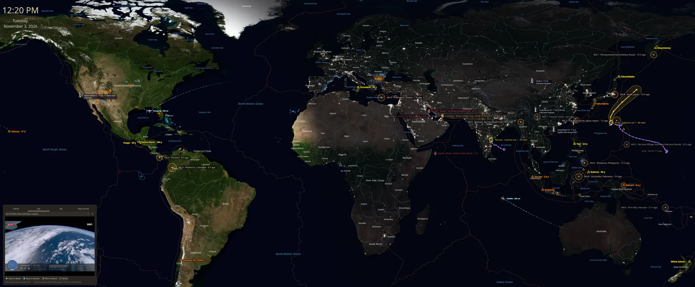
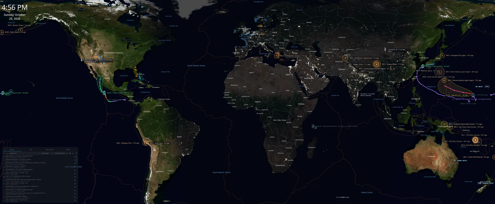
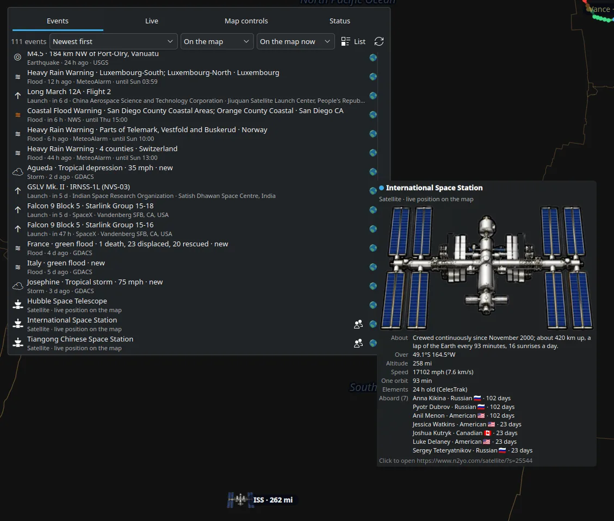
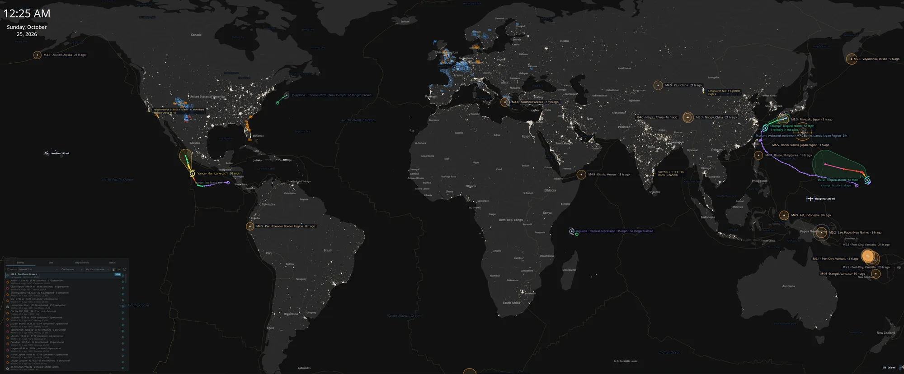
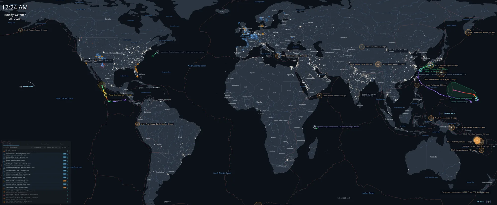

<p align="center">
  
</p>

<h1 align="center">Live World Map</h1>
<p align="center"><b>The planet on your desktop. Live. Free. Yours.</b><br>
A wallpaper and widget for KDE Plasma 6 that shows what the Earth is doing right now - earthquakes, storms, wildfires, floods, air raids, attacks at sea, the ISS and the next launch - and keeps doing it for months without asking anything of you.</p>

<p align="center">
  <a href="https://github.com/TidyBitz/livemap/releases/latest"></a>
  
  <a href="https://github.com/TidyBitz/livemap/actions/workflows/sources.yml"></a>
  <a href="docs/DEPENDENCIES.md"></a>
  <a href="LICENSE"></a>
</p>

<p align="center">
  <a href="#install-in-a-minute">Install</a> ·
  <a href="#whats-on-the-map">What's on the map</a> ·
  <a href="#the-widget">The widget</a> ·
  <a href="#styles">Styles</a> ·
  <a href="#built-to-be-left-alone">Why it keeps working</a> ·
  <a href="docs/GUIDE.md">Guide</a> ·
  <a href="docs/SOURCES.md">Sources</a> ·
  <a href="CHANGELOG.md">Changelog</a>
</p>

---

## Install in a minute

```bash
bash livemap.sh doctor          # what is missing, if anything - with the package names for your distro
bash livemap.sh install ~/Downloads/livemap.zip
bash livemap.sh activate        # the map on every desktop
```

Download `livemap.zip` from the [latest release](https://github.com/TidyBitz/livemap/releases/latest). KDE Plasma 6, Python 3.9+; nothing else. The widget is under *Add Widgets* as **Live World Map Events**. The first run fetches about 50 MB of maps and borders; after that the traffic is a few hundred KB an hour. [The longer version](docs/GUIDE.md): the first-run downloads, where things live, the script, and what to do when something does not show up.

## What's on the map

<table>
<tr>
<td width="33%" valign="top">

**🌋 Earth**
Earthquakes (USGS + EMSC, swarms clustered to one label), volcanoes with alert levels from four agencies and ash advisories, tsunami bulletins with the threatened coast drawn, floods and official flood warnings on four continents, wildfires with their perimeters and hotspots.

</td>
<td width="33%" valign="top">

**🌀 Weather**
Live clouds from the geostationary satellites (stitched from five of them when the usual mosaic is down), tropical storms with intensity-coloured tracks and a forecast cone for every one, the day/night line and city lights - or the whole map at night.

</td>
<td width="33%" valign="top">

**🛰️ Space**
ISS, Hubble and Tiangong on their orbits with their crews, the next launches counting down on their pads and the last day's with its outcome, passes over your home, the planetary K index.

</td>
</tr>
<tr>
<td valign="top">

**⚓ Security**
Ukraine's air raid alerts by oblast as edge lights, every minute; attacks, boardings, hijacks and kidnaps at sea from three centres - UKMTO from the Red Sea to the Strait of Hormuz, MDAT-GoG in the Gulf of Guinea, ReCAAP across Asia.

</td>
<td valign="top">

**🗺️ Geography**
Seven map styles, borders, rivers, lakes and seas, time zones, tectonic plates, oil and gas infrastructure - every one its own switch, every colour yours. Off by default and never leaving the machine: your own network connections on the map.

</td>
<td valign="top">

**🧭 The widget**
Newest events with source links, a bubble with the facts, the satellite's view and the ship's photograph, the ISS live stream, your local weather, air quality, aurora and the last hour of rain radar.

</td>
</tr>
</table>

<table><tr>
<td width="50%"><br><sub><b>Air raid alerts</b> - every oblast's border glows while an alert is on; new ones breathe, the frontline's settle to ochre</sub></td>
<td width="50%"><br><sub><b>Storms</b> - tracks coloured by intensity, a cone for every one, the facilities it threatens counted on the label</sub></td>
</tr></table>

## The widget

<table><tr>
<td width="50%"><br><sub>Rest the pointer on a row: the satellite's view, the facts, the source's own picture where it has one</sub></td>
<td width="50%"><br><sub>The ISS right now, and who is aboard</sub></td>
</tr></table>

Four tabs: **Events** (newest first, with NEW / SOON / LIVE tags and a link per row), **Live** (Earth from the ISS in 4K, NASA's feeds, launch webcasts), **Sky** (your weather, air quality, aurora, passes, and the last hour of rain radar), **Map controls** (every layer, every source's health). Hover a row and the event is marked on the map - ring, glow, spotlight, reticle or beacon, your choice. It fades when you're not using it.

## Styles

<table><tr>
<td width="33%"><br><sub>Matrix</sub></td>
<td width="33%"><br><sub>Dark Matter</sub></td>
<td width="33%"><br><sub>Dark cartographic</sub></td>
</tr></table>

Seasonal Blue Marble, today's satellite view, relief, Classic Blue Marble too - and every colour, size and label is a setting. [More screenshots.](docs/screenshots)

## Built to be left alone

Most live wallpapers die the first time a feed changes. This one is built for the weeks after you stop looking at the settings:

- **Every feed keeps its last good data** and shows it with its age; nothing ever goes blank.
- **Two sources where one would do** - EMSC beside USGS, three agencies for storms, three centres for the sea, five satellites stitched into clouds when the usual mosaic is down.
- **A daily probe on GitHub** asks every source whether it still answers, and opens an issue when one stops. [See today's run.](https://github.com/TidyBitz/livemap/actions/workflows/sources.yml)
- **A load guard** pauses the animation, or unloads the live layers, when your CPU or GPU is busy; on battery, a plain map.
- **No keys, no accounts, no telemetry.** Every source is free and public; nothing about you leaves the machine; nothing downloaded is code. [What it depends on.](docs/DEPENDENCIES.md)

### What it is not

It is not real-time tracking of anything that doesn't publish its position: no warships, no aircraft, no rocket in flight. It is not a forecast service beyond the week your home's weather tab shows. It will not draw a dot it cannot stand behind - a satellite picture that isn't there yet comes back later rather than black, a stream's picture is labelled as running behind the station, a weekly source is shown with the week on it. Where a free source doesn't exist, the layer doesn't either.

## Go deeper

| | |
|---|---|
| [Guide](docs/GUIDE.md) | installing, the first run, where things live, the script, the repository layout, troubleshooting |
| [Every layer and its sources](docs/SOURCES.md) | what each feed is, its format, and how it is handled |
| [Coverage by region](docs/COVERAGE.md) | which source covers which hazard where, and how fast |
| [Dependencies](docs/DEPENDENCIES.md) | the standard library, three optional packages, and nothing fetched is code |
| [Maintaining](docs/MAINTAINING.md) | the map of the code and the routine when a source breaks |
| [Changelog](CHANGELOG.md) · [Contributing](CONTRIBUTING.md) · [Security](SECURITY.md) | |

## Licence

GNU General Public License v3.0 or later - see [LICENSE](LICENSE). The storm icon set and the spacecraft
and launch-pad pictures are by tidybitz, CC BY 4.0. Copyright (C) 2026 tidybitz.

<details>
<summary><b>Credits</b></summary>

NASA Earth Observatory (Blue Marble Next Generation, Black Marble 2016) · Made with Natural Earth · Plate boundaries: PB2002,
Peter Bird (2003), GeoJSON by Hugo Ahlenius / Nordpil (github.com/fraxen/tectonicplates, ODC-By) ·
USGS Earthquake Hazards Program · EMSC (European-Mediterranean Seismological Centre) · USGS ShakeMaps · Smithsonian Institution Global Volcanism Program · USGS Volcano Hazards
Program (HANS) · GeoNet (GNS Science, New Zealand) · Japan Meteorological Agency · NOAA / NWS Washington VAAC · NOAA / NWS Pacific and National Tsunami Warning Centers (tsunami.gov) ·
NOAA National Weather Service (api.weather.gov) · MeteoAlarm (EUMETNET) · Environment and Climate Change Canada · Environment Agency (England, OGL) ·
alerts.in.ua · UKMTO / Royal Navy (Crown copyright) · MDAT-GoG / SEVERINE (Marine nationale and Royal Navy) · ReCAAP ISC · Ship photographs: Wikimedia Commons (each under its own licence, credited in the bubble) · Open-Meteo (CC BY 4.0) · NOAA Space Weather Prediction Center · Radar: RainViewer · NASA Worldview snapshots · Global Disaster Alert and Coordination System (GDACS) · NOAA National Hurricane Center · Joint Typhoon Warning Center ·
NASA FIRMS (VIIRS and MODIS, LANCE/EOSDIS) · CelesTrak · The Space Devs (Launch Library 2, launches and who is in space) · Matt Eason's
live-cloud-maps (EUMETSAT data) · NASA GIBS (GOES, Himawari) · EUMETSAT EUMETView (Meteosat) ·
IP Geolocation by DB-IP (https://db-ip.com, CC BY 4.0) · issinfo.net (who is in space) · BSEE / BOEM platform
structures · (c) OpenStreetMap contributors, ODbL (offshore platforms, refineries).

</details>
