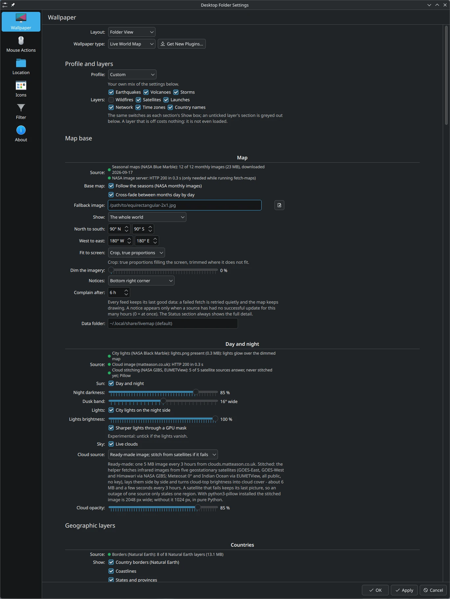
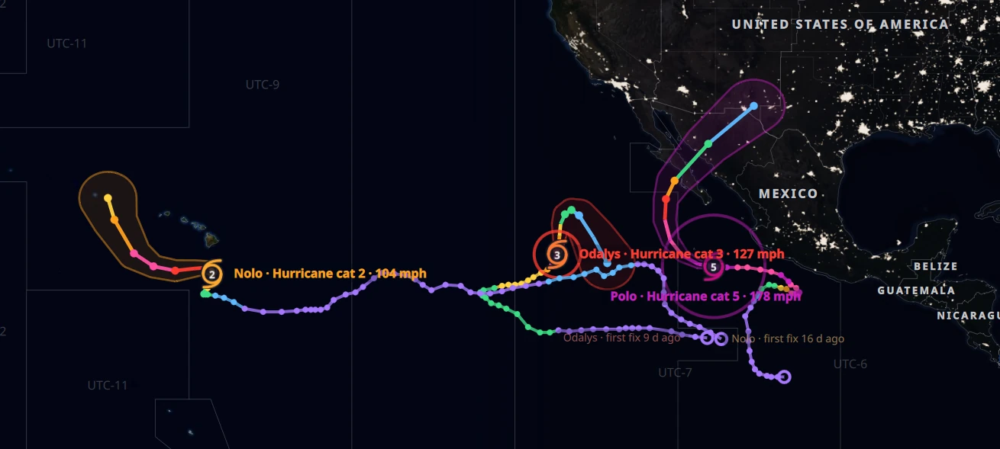
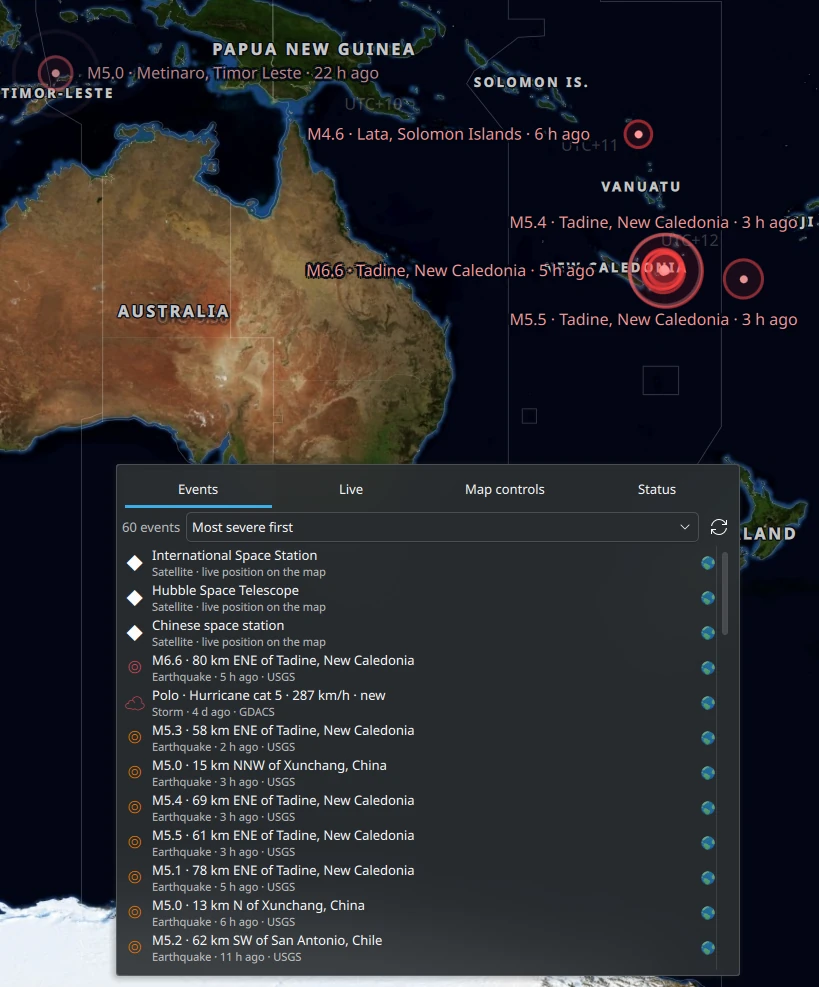
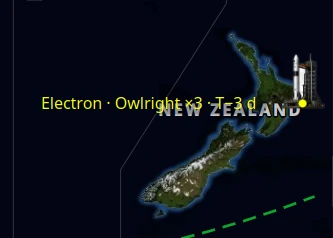

# Live World Map

A live situational-awareness wallpaper for KDE Plasma 6, with a companion panel widget.

One equirectangular world map, and on it - each layer its own tick box - the day/night line and city
lights, live clouds, earthquakes, volcanoes with their alert history, tropical storms with their track
coloured by intensity, wildfires, the ISS, Hubble and Tiangong gliding along their orbits, the next rocket
launches counting down on their pads, time zones, borders, and (optionally, never leaving your machine)
where your own computer is connected to right now.

It is built to sit on a desktop for weeks: every feed keeps its last good data and only says something when
it has been stale for hours, the clouds fall back to imagery stitched locally from five geostationary
satellites when the usual source is down, and a load guard pauses the animation - or hides the live
layers entirely - when the CPU or GPU is busy with something else, so a game or a build never fights the
wallpaper for frames.

| | |
|---|---|
|  |  |
| *Clouds off: day/night, city lights, borders and every event layer* | *Cropped to North America: storm tracks, launches and quake labels up close* |
|  |  |
| *The companion widget's Events tab: launches, quakes and storms with NEW tags and source links* | *The settings page: profile and layer switches, then one section per layer with the live state of its sources* |

### A closer look

*Tropical storms: each piece of the track takes the colour of the wind the storm had at that fix, from depression
blue through tropical-storm green to category 5 magenta. Forecast cone and points, a dot at every fix, and a ring
where the storm was first fixed.*

| | |
|---|---|
|  |   |
| *A swarm off New Caledonia: rings sized by magnitude, the strongest pulsing, and the widget listing the same quakes most severe first* | *A launch counts down on its pad, then shows lift-off for two minutes after T-0* |

## Features

| | What you get | Where it comes from |
|---|---|---|
| **Base map** | NASA Blue Marble imagery blended month by month for the seasons, Black Marble city lights on the night side, dimming and framing (Stretch / Fit / Crop, "without Antarctica", "where people live", or your own limits) | NASA (downloaded once, ~350 MB with borders) |
| **Day and night** | Terminator with twilight band, city lights glowing through the shade, recomputed locally every 2 min | Sun position, computed locally |
| **Clouds** | Live cloud cover, adjustable opacity; when the usual source is down the helper stitches its own from five geostationary satellites | live-cloud-maps (EUMETSAT); GOES-East/West, Himawari, Meteosat |
| **Geography** | Coastlines, country and state borders, country names with halo and de-clutter, time-zone outlines with UTC offsets; colour, opacity, thickness and detail per layer | Natural Earth (downloaded once) |
| **Earthquakes** | Rings sized by magnitude, pulsing when new or strong, labels with place and age, ageing colour drift, magnitude filter; tectonic plate boundaries as fault lines in their own colour, opacity and thickness | USGS, every 5 min; PB2002 plate model (downloaded once) |
| **Volcanoes** | Hollow triangles coloured by alert level (yellow / orange / red), pulse on first report or level change, label with how long above normal | Smithsonian GVP eruption database and weekly report, USGS HANS, hourly |
| **Tropical storms** | NHC-style cyclone icon with category number, past track and forecast coloured by intensity at each fix (depression to category 5), forecast cone, first-fix marker; storms keep their identity across sources and age out instead of vanishing | GDACS worldwide; NOAA NHC best track and forecast for the Atlantic and Pacific, every 30 min |
| **Wildfires** | GDACS events as flames sized by burned area, plus MODIS hotspots clustered into half-degree cells and sized by fire power; level and size filters | GDACS, NASA FIRMS, hourly |
| **Spacecraft** | ISS, Hubble and Tiangong as pictures or symbols moving once a second along a fading ground track (30 min, one or two orbits ahead), altitude in km, mi or nmi | CelesTrak elements, propagated locally (Kepler + J2) |
| **Rocket launches** | Rocket on its pad with a live countdown; last ten minutes in mm:ss with a growing amber label, "LIFT-OFF" then a lift-off picture | The Space Devs Launch Library 2, hourly |
| **Network activity** *(off by default)* | Arcs from your home city to every host this machine is connected to, animated packets, kernel round-trip times, first-time places highlighted, closed connections fading out; nothing leaves the machine | Local sockets via `ss`, DB-IP Lite offline geolocation, every 10 s |
| **Labels** | One layout pass above every layer: real-width overlap avoidance, flip to the free side, leader lines, plates and per-type text colours, one-line / two-line / automatic | - |
| **Life cycle** | Every event pulses while newly reported, sits steady while listed, then drifts to an aged colour and is removed; a change of status counts as new again | Helper memory (`events.json`) |
| **Resilience** | Every feed keeps its last good data; a desktop notice only after a source has been stale for hours; HTTPS only, size-capped, parsed as data, rendered as plain text | - |
| **Performance and power** | High performance / Balanced / Power saving profiles; 10-60 animation updates a second, stopped when idle; the still map cached as one texture; load guard pauses animation or unloads live layers when CPU or GPU is busy; on-battery policy | sysfs / nvidia-smi / CPU, polled every 20 s |
| **Companion widget** | Newest events with source links, sorted by time, severity, kind or "what is next", NEW / SOON / LIVE tags; ISS and launch webcasts embedded, in mpv or in the browser; map controls (pause, plain map, hide layers, clouds on/off and opacity, full speed on demand for a set time); status of every data source | Shares the wallpaper's helper and caches |
| **Command line** | `livemap.sh` doctor / install / activate / deactivate / remove / purge / status, with per-distro install hints for Fedora, Arch, openSUSE and Debian/Ubuntu/neon | - |

## Install

Requirements: KDE Plasma 6 on Linux, Python 3.9 or newer, and the QML modules Plasma normally ships with.
`livemap.sh doctor` checks every one of them and prints the exact packages to install for Fedora, Arch,
openSUSE and Debian/Ubuntu/KDE neon; `install` refuses to continue while a required one is missing.

Download `livemap.zip` from the latest release, then:

    bash livemap.sh doctor                          # what is missing, if anything
    bash livemap.sh install ~/Downloads/livemap.zip
    bash livemap.sh activate                        # make it the wallpaper on every desktop

Then right-click the desktop > *Configure Desktop and Wallpaper* > **Status** > *Download maps and border
data* (about 350 MB from NASA and Natural Earth, once). Until then the map shows the single image you pick
in the settings. The widget is under *Add Widgets* as **Live World Map Events**.

Everything is per user and nothing runs in the background: the wallpaper is QML inside plasmashell, and the
helper is a Python script (standard library only) that runs for a few seconds per fetch.

Optional extras, each for a feature that is off by default: `python3-maxminddb` for the Network layer,
QtWebEngine for the embedded ISS and launch streams in the widget, Pillow for faster cloud stitching.

## The script

    livemap.sh doctor [--report]         check every dependency; --report adds versions, GPU, logs for a bug report
    livemap.sh install [livemap.zip]     check, then install or update the wallpaper and the widget
    livemap.sh activate | deactivate     switch every desktop to the map / back to the stock image
    livemap.sh remove                    deactivate, remove the widget from panels, uninstall both packages
    livemap.sh purge [--yes]             remove, then delete the data folder and the saved settings
    livemap.sh status                    what is installed, active, running and stored
    livemap.sh help [command]

## Layers and sources

| Layer | Source | Refresh |
|---|---|---|
| Base map, seasons, city lights | NASA Blue Marble Next Generation, Black Marble (downloaded once) | monthly blend, computed locally |
| Day / night, twilight | computed locally from the sun's position | every 2 min |
| Clouds | Matt Eason's live-cloud-maps (EUMETSAT); fallback stitched from GOES-East/West, Himawari (NASA GIBS) and Meteosat (EUMETView) | every 3 h |
| Borders, coasts, names, time zones | Natural Earth (downloaded once) | - |
| Earthquakes | USGS Earthquake Hazards Program | every 5 min |
| Plate boundaries | PB2002 (Peter Bird 2003; GeoJSON by Hugo Ahlenius / Nordpil, ODC-By), downloaded with the borders | - |
| Volcanoes | Smithsonian Global Volcanism Program (eruption database, weekly report), USGS alert levels (HANS) | hourly |
| Storms | GDACS worldwide; NOAA NHC for current intensity, best track and forecast in the Atlantic and Pacific | every 30 min |
| Wildfires | GDACS events, NASA FIRMS hotspots (MODIS) | hourly |
| ISS, Hubble, Tiangong | CelesTrak orbital elements, propagated locally (Kepler + J2) | position every second |
| Launches | The Space Devs, Launch Library 2 | hourly |
| Network (off by default) | this machine's sockets, DB-IP Lite geolocation, all local | every 10 s |

Every source is fetched over HTTPS only, capped in size, parsed as data and never executed; strings that end
up on the desktop are filtered and rendered as plain text. The data folder is `~/.local/share/livemap`.

## Companion widget

**Live World Map Events** lists the newest events with links to their sources (sorted by time, severity, kind
or "what is next"; NEW / SOON / LIVE tags), embeds or opens the ISS and launch webcasts, controls the map
(pause, plain map, hide layers, clouds on/off and opacity, and "full speed" to set aside the battery policy
and load guard for an hour or a few) and shows the status of every data source. It uses the wallpaper's
helper and caches; nothing is fetched twice.

## Repository layout

    livemap/            the wallpaper package (Plasma/Wallpaper)
      contents/ui/        QML: main.qml and one file per layer; geo.js for the maths
      contents/helper/    livemap-helper.py: every fetch, cache and calculation the QML cannot do
      contents/config/    main.xml, one <entry> per setting
      contents/images/    spacecraft, launch-pad and storm icons (CC BY 4.0)
    livemap-widget/     the companion widget package (Plasma/Applet)
    livemap.sh          install / doctor / activate / remove / purge / status
    scripts/check.py    static checks (settings ↔ config page, brackets, ids, versions); CI runs it
    scripts/package.sh  builds livemap.zip
    CHANGELOG.md        every release, newest first

Adding a layer: a new `FooLayer.qml`, an `<entry name="ShowFoo">` in main.xml, a `cfg_ShowFoo` alias and a
tick box in config.qml, and a `Loader` in main.qml. Layers exist only while ticked. `livemap/README.md`
has the developer notes (how the day/night shade avoids a shader, the `layer` id trap, and so on).

## If something does not show up

    bash livemap.sh doctor --report                       # dependencies, versions, the helper's status, last log lines
    journalctl --user -f | grep -i -E "livemap|qml"      # QML errors as they happen
    livemap-helper status | python3 -m json.tool          # the health report the settings page shows

Please open an issue with the output of `livemap.sh doctor --report`. Pull requests: see [CONTRIBUTING.md](CONTRIBUTING.md);
security issues: [SECURITY.md](SECURITY.md).

## Licence

GNU General Public License v3.0 or later - see [LICENSE](LICENSE). The storm icon set and the spacecraft
and launch-pad pictures are by tidybitz, CC BY 4.0. Copyright (C) 2026 tidybitz.

## Credits

NASA Earth Observatory (Blue Marble Next Generation, Black Marble 2016) · Made with Natural Earth · Plate boundaries: PB2002,
Peter Bird (2003), GeoJSON by Hugo Ahlenius / Nordpil (github.com/fraxen/tectonicplates, ODC-By) ·
USGS Earthquake Hazards Program · Smithsonian Institution Global Volcanism Program · USGS Volcano Hazards
Program (HANS) · Global Disaster Alert and Coordination System (GDACS) · NOAA National Hurricane Center ·
NASA FIRMS (MODIS, LANCE/EOSDIS) · CelesTrak · The Space Devs (Launch Library 2) · Matt Eason's
live-cloud-maps (EUMETSAT data) · NASA GIBS (GOES, Himawari) · EUMETSAT EUMETView (Meteosat) ·
IP Geolocation by DB-IP (https://db-ip.com, CC BY 4.0) · issinfo.net (who is in space).
